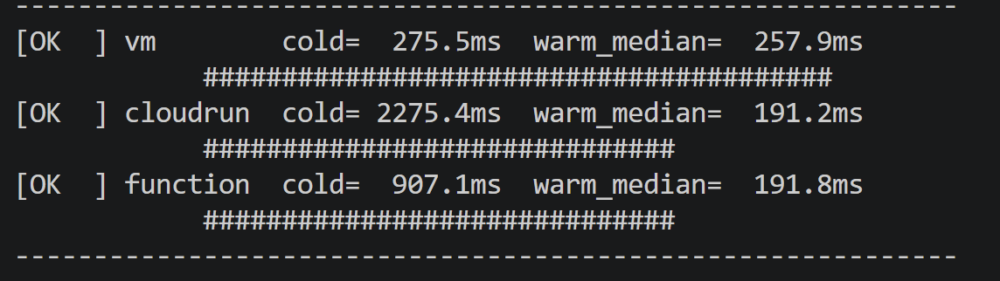

# Phase 1 — Comparison Report

Copy this file to `submission/phase1_report.md`, fill in every answer slot, and commit it:

```bash
cp phase-1-echo-bot/report_template.md submission/phase1_report.md
```

**How to fill it in.** Each answer sits between a pair of `<!--answer:...-->` markers. Replace
the `TODO` line with your answer — **leave the markers themselves untouched**, they are how the
grader finds your answers. Anything you write outside the markers is ignored, so add extra
prose, tables or images freely.

Numbers must **match `submission/phase1_report.json`** exactly — that file is produced by
`measure.py` and is what your figures are checked against. Copy them across; do not retype from
memory.

---

## 1. Setup facts

**Your image size**, in MB, from `gcloud artifacts docker images list` (number only, e.g. `142`):

<!--answer:image_size_mb-->
49
<!--/answer-->

**The custom VPC and subnet you created** (names only):

<!--answer:vpc_name-->
echo-net
<!--/answer-->

<!--answer:subnet_name-->
echo-subnet
<!--/answer-->

---

## 2. Measurements

Copy these from `submission/phase1_report.json`. Cold is `cold_ms`; warm median is
`stats.median`. Numbers only, in milliseconds (e.g. `812.4`).

| Platform | Cold (ms) | Warm median (ms) |
|---|---|---|
| IaaS VM | <!--answer:vm_cold_ms-->275.5<!--/answer--> | <!--answer:vm_warm_median_ms-->257.9<!--/answer--> |
| Cloud Run | <!--answer:cloudrun_cold_ms-->2275.4<!--/answer--> | <!--answer:cloudrun_warm_median_ms-->191.2<!--/answer--> |
| Cloud Function | <!--answer:function_cold_ms-->907.1<!--/answer--> | <!--answer:function_warm_median_ms-->191.8<!--/answer--> |

Include your histogram or plot of the warm distribution below (an image, or the ASCII chart
`measure.py` prints). This is read by a human, not the grader:

<!--answer:latency_plot-->
Phase 1 — deployment measurements

[OK  ] vm        cold=  275.5ms  warm_median=  257.9ms
            ########################################
[OK  ] cloudrun  cold= 2275.4ms  warm_median=  191.2ms
            ##############################
[OK  ] function  cold=  907.1ms  warm_median=  191.8ms
            ##############################


<!--/answer-->

---

## 3. Per-platform analysis

**Scaling behaviour.** Imagine requests arriving one at a time, then ten at once, then a
hundred. For each of the three platforms, answer concretely:

- Does anything get created automatically to absorb the load — and if so, *what* exactly?
  (One platform here creates nothing at all.)
- What is the hard limit, and where does it come from — a flag you passed yourself, or the
  size of the machine you picked?

(~80 words. Your `--machine-type=e2-micro` and `--max-instances=3` are both concrete answers
to the second question.)

<!--answer:scaling_behaviour-->
The VM does not create anything automatically: all requests reach the same instance, limited by the resources of the e2-micro machine. Cloud Run automatically creates additional container instances as demand increases, up to the configured --max-instances=3 limit. Cloud Functions also automatically creates additional function instances to handle concurrent requests, subject to its configured instance limits and Google Cloud quotas. Therefore, the VM is limited mainly by machine capacity, while Cloud Run and Cloud Functions scale automatically but can be constrained by instance limits.
<!--/answer-->

**Deployment effort.** What did you have to build, configure and maintain to get each of the
three running? (~100 words)

<!--answer:deployment_effort-->
For the VM, I built the Docker image, pushed it to Artifact Registry, provisioned an e2-micro virtual machine, configured network access and firewall rules, and deployed and ran the container on the machine. I must also maintain the VM and its running services. For Cloud Run, I reused the Docker image stored in Artifact Registry and deployed it as a service. Google manages the underlying infrastructure and automatic scaling. For Cloud Functions, I prepared the function entry point and dependencies, then deployed the source code. Google manages the execution infrastructure and scaling, reducing the amount of server maintenance required.
<!--/answer-->

---

## 4. Why do two of your three numbers look alike?

With Cloud Run and your Function both deployed, run `gcloud run services list` and paste the
**complete output** here, unedited:

<!--answer:run_services_list-->
SERVICE   REGION       URL                                                 LAST DEPLOYED BY                                               LAST DEPLOYED AT
+  echo      us-central1  https://echo-1045468369640.us-central1.run.app      service-1045468369640@gcf-admin-robot.iam.gserviceaccount.com  2026-10-26T13:33:02.474597Z
+  echo-bot  us-central1  https://echo-bot-1045468369640.us-central1.run.app  Andrea.Russo@eurecom.fr                      2026-10-26T13:02:18.666359Z
<!--/answer-->

Now explain what that output tells you about how your Function is actually being run, why its
cold start resembles Cloud Run's so closely, and what — if anything — genuinely differs between
the two deployment paths. (~120 words)

<!--answer:convergence_explanation-->
The output shows that my Cloud Function (`echo`) also runs on Cloud Run infrastructure, which helps explain why both deployment options can have similar performance. However, my measurements were not entirely consistent. After approximately 15 minutes of inactivity, Cloud Run had a cold-start latency of 2275.4 ms, compared with 907.1 ms for Cloud Functions. In an earlier measurement, their cold-start latencies were much closer: 215.5 ms and 212.0 ms, respectively. This suggests that the later result may reflect temporary infrastructure conditions or measurement variability rather than a consistent performance difference. More repeated experiments would be needed to determine whether this difference is statistically significant. The warm median latencies were very similar in both experiments. I did not perform further measurements after pushing the first report containing the results collected after 15 minutes of inactivity, so I cannot verify whether the unusually high Cloud Run cold-start latency was reproducible. The main difference remains the deployment model: a container image for Cloud Run versus source-based deployment for Cloud Functions.
<!--/answer-->
